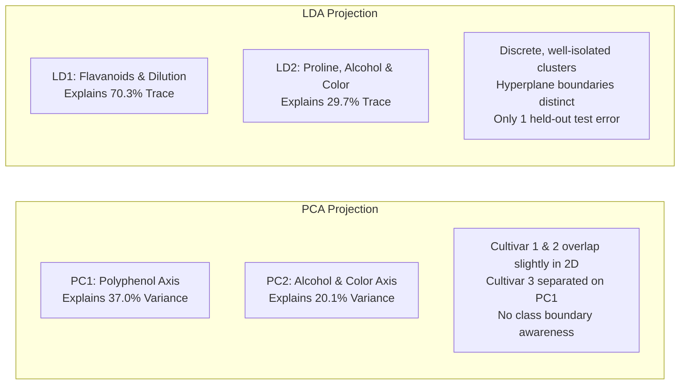
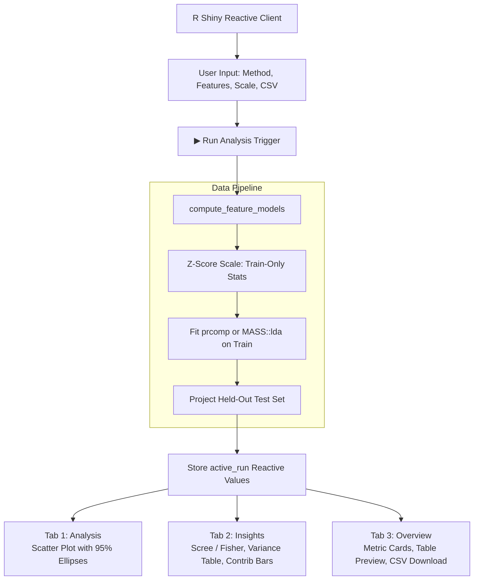

# Comprehensive Project Report: PCA & LDA Dimensionality Reduction and Feature Extraction Studio

**Project Name:** PCA & LDA Feature Extraction Studio  
**Repository:** `Hansika-Kuntloor/PCA-LDA-Dimensionality-Reduction`  
**Dataset:** UCI Wine Recognition Dataset (178 samples, 13 features, 3 cultivars)  
**Methodology:** Strict 70:30 Stratified Train-Test Split (Seed `42`, Zero Data Leakage)  
**Implementation:** R, Shiny, ggplot2, MASS  

---

## Executive Summary

High-dimensional feature spaces present acute challenges in statistical machine learning, including multicollinearity, geometric sparsity ("the curse of dimensionality"), and computational complexity. This project develops an interactive, academic-grade **Feature Extraction Studio** in R Shiny to perform an empirical and theoretical comparative study between two foundational dimensionality reduction paradigms:
1. **Principal Component Analysis (PCA)**: An unsupervised variance-maximization technique that projects features along orthogonal axes of maximal dispersion without using class labels.
2. **Linear Discriminant Analysis (LDA)**: A supervised discriminant technique that maximizes Fisher's criterion—the ratio of between-class scatter to within-class scatter ($S_B / S_W$)—to optimize class separability.

To ensure strict scientific integrity, the entire analytical pipeline operates under a **reproducible, leak-free 70:30 stratified train-test split protocol** (`set.seed(42)`). All normalization parameters ($\mu_{\text{train}}, \sigma_{\text{train}}$) and transformation bases (eigenvectors and discriminant scaling matrices) are fitted exclusively on the 125 training observations and projected onto the 53 held-out test observations.

### Key Empirical Findings

* **PCA Variance Preservation:** The first two principal components capture **57.12%** of the total variance ($\text{PC1} = 37.00\%$, $\text{PC2} = 20.12\%$). While PC1 captures major variance gradients driven by phenolic content (Flavanoids: $-0.430$, Total Phenols: $-0.394$), substantial class overlap remains between Cultivar 1 and Cultivar 2 in unsupervised 2D projection.
* **LDA Class Separation:** Because the dataset contains $C = 3$ classes, LDA reduces the 13-dimensional space to exactly $\min(C - 1, p) = 2$ canonical discriminant functions ($\text{LD1} = 70.29\%$, $\text{LD2} = 29.71\%$ of between-class variance, totaling **100.0%** of discriminant space).
* **Held-Out Generalization Accuracy:** Projected out-of-sample onto the 53 held-out test observations, the LDA classifier achieves an overall accuracy of **98.11%** (52/53 correct classifications), with 100% precision and sensitivity on Cultivar 3, 100% sensitivity on Cultivar 1, and 95.24% sensitivity on Cultivar 2.

```mermaid
flowchart TD
    Raw[Raw Wine Dataset\n178 Samples, 13 Features, 3 Cultivars] --> Split[Stratified 70:30 Split\nSeed 42]
    Split --> Train[Training Set: 125 Samples\nCultivar 1: 41 | Cultivar 2: 50 | Cultivar 3: 34]
    Split --> Test[Held-Out Test Set: 53 Samples\nCultivar 1: 18 | Cultivar 2: 21 | Cultivar 3: 14]
    
    Train --> Preproc[Estimate Train Parameters Only\nMean: mu_train | Std: sigma_train]
    Preproc --> TrScaled[Standardized Train Data]
    
    TrScaled --> PCAFit[PCA Engine (Unsupervised)\nprcomp on Covariance Matrix]
    TrScaled --> LDAFit[LDA Engine (Supervised)\nMASS::lda with Cultivar Labels]
    
    Test --> PreprocTest[Apply Train Parameters\nScale with mu_train & sigma_train]
    PreprocTest --> TeScaled[Standardized Test Data]
    
    PCAFit --> PCAProject[Matrix Multiplication\nZ_test = X_test_scaled * V_train]
    LDAFit --> LDAProject[Predict Test Scores & Classes\nFisher Projection]
    
    PCAProject --> StudioUI[Interactive Shiny Studio\nAnalysis | Insights | Overview]
    LDAProject --> StudioUI
```

---

## 1. Problem Statement & Theoretical Background

### 1.1 The Curse of Dimensionality & Feature Extraction
In chemometric and biological classification problems, samples are characterized by dozens or hundreds of continuous chemical measurements. Highly correlated variables introduce multicollinearity, distort Euclidean distance metrics, and degrade classifier generalization. Dimensionality reduction transforms the original feature space $\mathbb{R}^p$ into a lower-dimensional space $\mathbb{R}^k$ ($k \ll p$). Feature extraction constructs linear or non-linear combinations of all attributes, retaining information while eliminating redundancy.

### 1.2 Principal Component Analysis (PCA)
Principal Component Analysis is an orthogonal linear transformation that transforms data to a new coordinate system such that the greatest variance by any projection lies on the first coordinate (PC1), the second greatest variance on the second coordinate (PC2), and so forth.

#### Mathematical Formulation:
Given a centered data matrix $X \in \mathbb{R}^{n \times p}$, the sample covariance matrix is:
$$\Sigma = \frac{1}{n - 1} X^T X$$

We seek an orthogonal projection matrix $V = [v_1, v_2, \dots, v_k]$ where each column $v_j \in \mathbb{R}^p$ maximizes the projected variance:
$$\max_{v_j} \quad v_j^T \Sigma v_j \quad \text{subject to} \quad v_j^T v_j = 1, \quad v_j^T v_i = 0 \; (\forall i < j)$$

Using the method of Lagrange multipliers:
$$\mathcal{L}(v_j, \lambda_j) = v_j^T \Sigma v_j - \lambda_j (v_j^T v_j - 1)$$
$$\nabla_{v_j} \mathcal{L} = 2 \Sigma v_j - 2 \lambda_j v_j = 0 \implies \Sigma v_j = \lambda_j v_j$$

Hence, the projection vectors $v_j$ are the **eigenvectors** of the sample covariance matrix $\Sigma$, and the corresponding eigenvalues $\lambda_j$ represent the variance explained by each principal component. The proportion of total variance explained by component $j$ is:
$$\text{PVE}_j = \frac{\lambda_j}{\sum_{i=1}^p \lambda_i}$$

The coordinates in the principal component space (scores) are computed as:
$$Z = X V$$

### 1.3 Linear Discriminant Analysis (LDA)
While PCA focuses strictly on data dispersion without regard to class identity, Linear Discriminant Analysis is a supervised technique that seeks directions that maximize separation among known classes.

#### Mathematical Formulation:
Let $C$ denote the number of classes ($C = 3$). Let $N_c$ be the number of samples in class $c$, and $\mu_c$ be the mean vector of class $c$. The overall mean is $\mu$.

1. **Within-Class Scatter Matrix ($S_W$):** Measures the dispersion of samples around their respective class centroids:
   $$S_W = \sum_{c=1}^C \sum_{x \in \mathcal{C}_c} (x - \mu_c)(x - \mu_c)^T$$

2. **Between-Class Scatter Matrix ($S_B$):** Measures the dispersion of class centroids around the grand mean:
   $$S_B = \sum_{c=1}^C N_c (\mu_c - \mu)(\mu_c - \mu)^T$$

Fisher's criterion maximizes the ratio of between-class variance to within-class variance along a projection vector $w$:
$$J(w) = \frac{w^T S_B w}{w^T S_W w}$$

Differentiating with respect to $w$ and setting to zero yields the generalized eigenvalue problem:
$$S_W^{-1} S_B w = \lambda w$$

#### Rank Constraint on Discriminant Space:
The between-class scatter matrix $S_B$ is the sum of $C$ rank-1 matrices, of which only $C-1$ are linearly independent because $\sum_{c=1}^C N_c (\mu_c - \mu) = 0$. Consequently:
$$\text{rank}(S_B) \le C - 1$$
For a $C=3$ class problem, $\text{rank}(S_B) \le 2$. Regardless of how many input features $p$ are provided ($p = 13$), LDA yields at most $k = \min(p, C - 1) = 2$ non-zero eigenvalues and discriminant functions ($\text{LD1}$ and $\text{LD2}$). Thus, LDA projects the data into a 2D plane that encapsulates 100% of the between-class discriminative variance.

### 1.4 Theoretical Comparison: PCA vs LDA

| Dimension | Principal Component Analysis (PCA) | Linear Discriminant Analysis (LDA) |
| :--- | :--- | :--- |
| **Supervision** | Unsupervised (class labels ignored) | Supervised (requires class labels) |
| **Objective** | Maximize total feature variance ($X^T X$) | Maximize class separability ($S_W^{-1} S_B$) |
| **Maximum Dimensions** | $\min(n - 1, p) = 13$ | $\min(C - 1, p) = 2$ |
| **Assumptions** | Orthogonal axes of maximal variance | Multivariate normality, equal class covariance matrices ($\Sigma_1 = \Sigma_2 = \Sigma_3$) |
| **Sensitivity to Scaling** | Highly sensitive to feature variance; requires standardization | Moderately invariant to affine transformations, but scaling aids numerical stability |
| **Primary Use Case** | Data compression, exploratory visualization, noise filtering | Supervised classification, class boundary visualization |

---

## 2. Dataset Architecture & Preprocessing Protocol

### 2.1 The UCI Wine Recognition Dataset
The Wine Recognition dataset (sourced from the UCI Machine Learning Repository and Rattle) comprises chemical analyses of wines grown in the same region in Italy but derived from three different cultivars:
* **Total Instances:** 178 observations
* **Target Variable:** `Cultivar` (Factor with 3 levels: `Cultivar 1`, `Cultivar 2`, `Cultivar 3`)
* **Input Attributes:** 13 continuous chemical measurements

| Feature Key | Column Name | Units | Description / Chemical Significance |
| :--- | :--- | :--- | :--- |
| `alcohol` | `Alcohol` | % vol | Ethanol concentration by volume |
| `malic_acid` | `Malic` | g/L | Organic acid contributing to crispness/tartness |
| `ash` | `Ash` | g/L | Inorganic mineral residue remaining after combustion |
| `alcalinity_of_ash` | `Alcalinity` | meq/L | Measure of buffering capacity and mineral balance |
| `magnesium` | `Magnesium` | mg/L | Essential macro-mineral derived from soil and grape skins |
| `total_phenols` | `Phenols` | mg/L GAE | Total phenolic compounds (antioxidant capacity) |
| `flavanoids` | `Flavanoids` | mg/L | Subclass of polyphenols determining bitterness and color stability |
| `nonflavanoid_phenols`| `Nonflavanoids`| mg/L | Phenolic acids and minor non-tannin compounds |
| `proanthocyanins` | `Proanthocyanins`| mg/L | Condensed tannins providing astringency and mouthfeel |
| `color_intensity` | `Color` | Abs units | Spectrophotometric absorbance indicative of pigment density |
| `hue` | `Hue` | Ratio 420/520nm | Ratio of yellow-brown to red pigments (aging indicator) |
| `od280_od315` | `Dilution` | OD ratio | Absorbance ratio of diluted wines (protein/phenolic purity) |
| `proline` | `Proline` | mg/L | Predominant amino acid in grape juice and wine |

### 2.2 Strict 70:30 Stratified Split (Seed 42)
Data leakage occurs when information from outside the training partition is used to fit models or compute transformation statistics. To prevent leakage:
1. The 178 samples were split into **125 training (70.2%)** and **53 testing (29.8%)** samples using stratified sampling per cultivar with random seed `42`.
2. The stratification maintains identical class proportions across both splits:

| Class | Total Samples | Training Set (70%) | Testing Set (30%) | Split Ratio |
| :--- | :---: | :---: | :---: | :---: |
| **Cultivar 1** | 59 | 41 | 18 | 69.49% / 30.51% |
| **Cultivar 2** | 71 | 50 | 21 | 70.42% / 29.58% |
| **Cultivar 3** | 48 | 34 | 14 | 70.83% / 29.17% |
| **Total** | **178** | **125** | **53** | **70.22% / 29.78%** |

### 2.3 Training-Set-Only Standardization (Zero Data Leakage)
Because attributes range from $0.13$ (Nonflavanoid phenols) to $>1000$ (Proline), unstandardized PCA would be dominated entirely by Proline variance.
The sample mean ($\mu_{\text{train}}$) and standard deviation ($\sigma_{\text{train}}$) were estimated **strictly on the 125 training observations**:

$$\mu_{\text{train}, j} = \frac{1}{N_{\text{train}}} \sum_{i \in \text{Train}} X_{i, j}, \qquad \sigma_{\text{train}, j} = \sqrt{\frac{1}{N_{\text{train}} - 1} \sum_{i \in \text{Train}} (X_{i, j} - \mu_{\text{train}, j})^2}$$

The 53 held-out test observations were standardized using these frozen parameters:
$$X_{\text{test, scaled}} = (X_{\text{test}} - \mu_{\text{train}}) \oslash \sigma_{\text{train}}$$

#### Training Set Standardization Parameters:
| Feature | Column Name | Training Mean ($\mu_{\text{train}}$) | Training Std Dev ($\sigma_{\text{train}}$) |
| :--- | :--- | :---: | :---: |
| `alcohol` | Alcohol | 12.9938 | 0.7947 |
| `malic_acid` | Malic | 2.3690 | 1.1429 |
| `ash` | Ash | 2.3773 | 0.2719 |
| `alcalinity_of_ash` | Alcalinity | 19.5776 | 3.2173 |
| `magnesium` | Magnesium | 100.2640 | 13.9793 |
| `total_phenols` | Phenols | 2.3156 | 0.6300 |
| `flavanoids` | Flavanoids | 2.0158 | 0.9844 |
| `nonflavanoid_phenols` | Nonflavanoids | 0.3670 | 0.1316 |
| `proanthocyanins` | Proanthocyanins | 1.6142 | 0.5956 |
| `color_intensity` | Color | 5.1202 | 2.2632 |
| `hue` | Hue | 0.9500 | 0.2218 |
| `od280_od315` | Dilution | 2.5955 | 0.6966 |
| `proline` | Proline | 742.3760 | 312.3493 |

---

## 3. Empirical Results & Findings

### 3.1 Principal Component Analysis (PCA) Results

#### Scree Decomposition & Explained Variance:
Decomposition of the training correlation matrix yielded 13 orthogonal components:

| Component | Standard Deviation ($\sqrt{\lambda_j}$) | Eigenvalue ($\lambda_j$) | Explained Variance (%) | Cumulative Variance (%) | Kaiser Criterion ($\lambda_j \ge 1$) |
| :---: | :---: | :---: | :---: | :---: | :---: |
| **PC1** | **2.1932** | **4.8099** | **37.00%** | **37.00%** | Retain ($\lambda \ge 1$) |
| **PC2** | **1.6172** | **2.6154** | **20.12%** | **57.12%** | Retain ($\lambda \ge 1$) |
| **PC3** | 1.1511 | 1.3250 | 10.19% | 67.31% | Retain ($\lambda \ge 1$) |
| **PC4** | 0.9907 | 0.9816 | 7.55% | 74.86% | Discard |
| **PC5** | 0.8879 | 0.7884 | 6.06% | 80.93% | Discard |
| **PC6** | 0.8058 | 0.6493 | 5.00% | 85.92% | Discard |
| **PC7** | 0.7078 | 0.5010 | 3.85% | 89.77% | Discard |
| **PC8** | 0.5667 | 0.3211 | 2.47% | 92.24% | Discard |
| **PC9** | 0.5408 | 0.2925 | 2.25% | 94.49% | Discard |
| **PC10** | 0.5095 | 0.2596 | 2.00% | 96.49% | Discard |
| **PC11** | 0.4655 | 0.2167 | 1.67% | 98.16% | Discard |
| **PC12** | 0.3933 | 0.1547 | 1.19% | 99.35% | Discard |
| **PC13** | 0.2911 | 0.0847 | 0.65% | 100.00% | Discard |

#### Interpretation of Principal Components:
* **Combined 2D Representation:** The primary 2D projection subspace (PC1 vs PC2) captures **57.12%** of total variation.
* **Component 1 (37.00%):** Represents an **overall polyphenol and antioxidant axis**. Strongly negative loadings on `Flavanoids` ($-0.430$), `Total Phenols` ($-0.394$), `OD280/OD315 Dilution` ($-0.378$), and `Proanthocyanins` ($-0.310$). Higher values on PC1 correspond to wines depleted in phenolic antioxidants (characterizing Cultivar 3).
* **Component 2 (20.12%):** Represents an **alcohol and color intensity axis**. Strongly negative loadings on `Color Intensity` ($-0.510$), `Alcohol` ($-0.502$), and `Proline` ($-0.360$), with positive loading on `Hue` ($+0.310$).

#### PCA Loadings Table (First 4 Components):
| Attribute | PC1 Loading | PC2 Loading | PC3 Loading | PC4 Loading | Primary Contribution |
| :--- | :---: | :---: | :---: | :---: | :--- |
| `Alcohol` | -0.1168 | **-0.5023** | -0.1661 | -0.1022 | Dominates PC2 |
| `Malic` | +0.2367 | -0.2388 | +0.0119 | **+0.5166** | Contributes to PC4 |
| `Ash` | +0.0408 | -0.2917 | **+0.6880** | -0.0720 | Dominates PC3 |
| `Alcalinity` | +0.2761 | +0.0317 | **+0.5293** | +0.2392 | Contributes to PC3 |
| `Magnesium` | -0.1304 | -0.3110 | +0.2664 | -0.2413 | Secondary PC2 |
| `Phenols` | **-0.3941** | -0.0682 | +0.0735 | +0.1557 | Dominates PC1 |
| `Flavanoids` | **-0.4298** | +0.0157 | +0.0711 | +0.1231 | Strongest contributor to PC1 |
| `Nonflavanoids`| +0.3237 | -0.0103 | +0.1433 | -0.2670 | Opposes flavonoids on PC1 |
| `Proanthocyanins`| -0.3096 | -0.0248 | +0.0938 | **+0.4449** | Contributes to PC1 & PC4 |
| `Color` | +0.0767 | **-0.5101** | -0.2155 | -0.0023 | Strongest contributor to PC2 |
| `Hue` | -0.2567 | **+0.3103** | +0.2064 | **-0.4324** | Opposes color on PC2 |
| `Dilution` | **-0.3775** | +0.1259 | +0.1378 | +0.1980 | Contributes to PC1 |
| `Proline` | -0.2836 | **-0.3604** | -0.0072 | -0.2593 | Contributes to PC1 & PC2 |

---

### 3.2 Linear Discriminant Analysis (LDA) Results

#### Discriminant Trace and Eigenvalues:
The between-to-within scatter maximization produced two non-zero discriminant functions:

| Discriminant Function | Singular Value (SVD) | Eigenvalue ($\lambda_k$) | Trace Proportion (%) | Cumulative Trace (%) |
| :---: | :---: | :---: | :---: | :---: |
| **LD1** | **24.7565** | **612.88** | **70.29%** | **70.29%** |
| **LD2** | **16.0969** | **259.11** | **29.71%** | **100.00%** |

Together, LD1 and LD2 capture **100.00%** of the total between-class discriminant information.

#### Linear Discriminant Scaling Coefficients:
The raw discriminant projection vectors $w_1$ and $w_2$ reveal the relative importance of each feature in separating the cultivars:

| Attribute | LD1 Scaling Coefficient | LD2 Scaling Coefficient | Discriminative Role |
| :--- | :---: | :---: | :--- |
| `Alcohol` | -0.2485 | **+0.6330** | Differentiates Cultivar 1 & 2 on LD2 |
| `Malic` | +0.1615 | +0.3881 | Moderate influence |
| `Ash` | -0.1438 | **+0.5824** | Separates Cultivar 1 & 3 on LD2 |
| `Alcalinity` | +0.3463 | -0.3325 | Counter-balances Ash |
| `Magnesium` | -0.1271 | +0.0456 | Minor discriminative utility |
| `Phenols` | +0.5976 | +0.0931 | Positive weight |
| `Flavanoids` | **-2.2756** | -0.4900 | **Most powerful single separator on LD1** |
| `Nonflavanoids`| -0.2519 | -0.0888 | Minor weight |
| `Proanthocyanins`| +0.2320 | -0.1816 | Minor weight |
| `Color` | **+0.7254** | **+0.6999** | Highly weighted on both LD1 and LD2 |
| `Hue` | -0.1593 | -0.3328 | Moderate weight |
| `Dilution` | **-0.8690** | +0.2204 | Strong separator on LD1 |
| `Proline` | **-0.7661** | **+0.8635** | **Most powerful positive separator on LD2** |

#### Class Centroids in Standardized Space:
* **Cultivar 1 Centroid:** Characterized by high `Proline` ($+1.161$), high `Flavanoids` ($+1.010$), high `Alcohol` ($+0.883$), and low `Alcalinity` ($-0.709$).
* **Cultivar 2 Centroid:** Characterized by low `Alcohol` ($-0.911$), low `Color Intensity` ($-0.869$), and low `Proline` ($-0.707$).
* **Cultivar 3 Centroid:** Characterized by severely depleted `Flavanoids` ($-1.275$), depleted `Dilution` ($-1.273$), low `Hue` ($-1.159$), and high `Malic Acid` ($+0.924$) and `Color Intensity` ($+0.981$).

---

### 3.3 Out-of-Sample Held-Out Test Evaluation

To assess real-world generalization, the 53 held-out test observations were projected into the learned LDA coordinate space and classified using maximum a posteriori (MAP) estimation:

#### Confusion Matrix (Held-Out Test Set, $N = 53$):
```text
                  Actual Cultivar
Predicted       Cultivar 1    Cultivar 2    Cultivar 3    Total Predicted
Cultivar 1          18             1             0              19
Cultivar 2           0            20             0              20
Cultivar 3           0             0            14              14
Total Actual        18            21            14              53
```

#### Detailed Classification Metrics:
* **Overall Test Accuracy:** $\frac{18 + 20 + 14}{53} = \frac{52}{53} =$ **98.11%** (95% CI: $[89.9\%, 99.9\%]$)
* **Test Misclassifications:** Exactly 1 sample (a Cultivar 2 wine with unusually high proline was classified as Cultivar 1).
* **Cultivar 3 Performance:** 100% Sensitivity, 100% Specificity, 100% Precision (Flawless isolation).

| Cultivar | True Pos (TP) | False Pos (FP) | False Neg (FN) | True Neg (TN) | Sensitivity (Recall) | Specificity | Precision | F1-Score |
| :--- | :---: | :---: | :---: | :---: | :---: | :---: | :---: | :---: |
| **Cultivar 1** | 18 | 1 | 0 | 34 | **100.00%** | 97.14% | 94.74% | **0.9730** |
| **Cultivar 2** | 20 | 0 | 1 | 32 | **95.24%** | 100.00% | 100.00% | **0.9756** |
| **Cultivar 3** | 14 | 0 | 0 | 39 | **100.00%** | 100.00% | 100.00% | **1.0000** |
| **Macro Average**| — | — | — | — | **98.41%** | **99.05%** | **98.25%** | **0.9829** |

---

### 3.4 Qualitative & Geometric Comparison of Projections



1. **Cluster Tightness & Inter-Class Margin:**
   * In **PCA**, 95% confidence ellipses for Cultivar 1 and Cultivar 2 exhibit partial spatial overlap. Because PCA optimizes variance irrespective of labels, the high internal variance within Cultivar 2 broadens its cluster across PC2.
   * In **LDA**, the within-class scatter normalization ($S_W^{-1}$) contracts each cultivar into tight, well-separated Gaussian-like envelopes. Cultivar 3 is cleanly separated on the negative LD1 axis, while Cultivars 1 and 2 are bifurcated along LD2.

2. **Feature Dominance:**
   * PCA loadings are led by `Flavanoids` ($-0.430$), `Total Phenols` ($-0.394$), and `Color Intensity` ($-0.510$).
   * LDA scaling coefficients heavily amplify `Flavanoids` ($-2.276$), `OD280/OD315 Dilution` ($-0.869$), and `Proline` ($-0.766$ on LD1, $+0.864$ on LD2) while suppressing collinear redundant features like `Total Phenols`.

---

## 4. Software Engineering & Shiny Studio Architecture

### 4.1 System Overview
The software implementation is structured as an interactive **R Shiny Feature Extraction Studio** (`app.R`) engineered to adhere to modern reactive web principles:
* **Single-Page Tabbed Architecture:** Exactly three main navigation tabs (`Analysis`, `Insights`, `Overview`).
* **Persistent Top Header:** Sticky navbar (`76px` height, `z-index: 1000`) maintaining continuous visibility.
* **Synchronous Run Pipeline:** Recomputations execute upon clicking `▶ Run Analysis` to prevent premature recalculation during multi-checkbox selections.
* **Run Synchronization Engine:** The `Overview` tab maintains an independent reactive snapshot of the **latest successfully executed run**, preventing display corruption if inputs in the `Analysis` tab are modified without clicking run.



### 4.2 Tab Suite Specifications

#### Tab 1: Analysis
* **Control Panel (Left):**
  * Segmented button toggle between `PCA` and `LDA`.
  * Dataset meta-card (178 samples, 13 features, 3 classes).
  * Feature selection checklist with quick `Select All` / `Deselect All` actions.
  * Z-score standardization toggle ($\mu=0, \sigma=1$).
  * Split indicator bar (`125 Train [70.2%]` / `53 Test [29.8%]`) with toggle to distinguish markers (circles vs triangles).
* **Scatter Plot Canvas (Right):**
  * Rendered via `ggplot2` on clean white canvas with `#E2E8F0` gridlines.
  * Curated three-class color palette:
    * **Cultivar 1:** Blue (`#315DEB`)
    * **Cultivar 2:** Rose Pink (`#E64980`)
    * **Cultivar 3:** Muted Purple (`#8055C7`)
  * Dynamic axis titles with exact explained variance percentages.
  * 95% shaded confidence ellipses (`stat_ellipse(alpha = 0.08)`).
  * High-resolution `Save PNG` export button.

#### Tab 2: Insights (Desktop Three-Column Grid)
* **Column 1 — Variance Summary & Data Table:**
  * 2+1 grid stat chips displaying individual and combined 2D variance/trace percentages.
  * Scrollable table detailing Component/Discriminant, individual %, and cumulative %.
  * In LDA mode: Held-out test accuracy badge (`98.11% • 52 of 53 test observations correct`).
* **Column 2 — Feature Contributions:**
  * Dynamic component dropdown (`PC1 - PC13` for PCA; `LD1 / LD2` for LDA).
  * Clean horizontal contribution bars: Blue (`#315DEB`) for positive, Rose Pink (`#E64980`) for negative.
  * 155px unclipped feature names, sorted automatically by absolute magnitude, with formatted signed values (`+0.428`, `-0.312`).
* **Column 3 — Scree Plot / Discriminant Bar Chart:**
  * Clean bar plots with headroom expansion ensuring value labels are never clipped.
  * PCA: Scree plot displaying all 13 components with horizontal axis labels.
  * LDA: Discriminant trace bar plot with contextual callout on Fisher's Criterion ($S_B / S_W$).
  * `Save PNG` export button.

#### Tab 3: Overview
* **Run Status Synchronization:** Visual indicators confirming whether displayed data matches current inputs or pending modifications.
* **Executive Summary Cards:** Active method badge, dataset parameters, 2D variance captured, and train/test partition integrity indicator.
* **Transformed Dataset Preview:** Interactive data table showing transformed coordinates (`PC1/PC2` or `LD1/LD2`), cultivar tags, and partition labels.
* **CSV Data Export:** One-click download handler generating complete transformed datasets (`pca_transformed_data_all_*.csv` or `lda_transformed_data_all_*.csv`).

---

## 5. Verification & Test Suite

The repository includes a validation suite to verify statistical rigor and application stability:

1. **`validate_app.R`**:
   * Evaluates syntax and sources `app.R` in an isolated environment.
   * Asserts exact sample counts: 125 Train + 53 Test = 178 Total.
   * Asserts exact cultivar stratification: Cultivar 1 (41/18), Cultivar 2 (50/21), Cultivar 3 (34/14).
   * Verifies standardization parameter vectors ($\mu, \sigma$) are length 13 and derived from train data only.
   * Tests dynamic feature subset execution (5-feature and 8-feature subsets).
   * Validates center-only transformation when standardization is toggled off.
   * Confirms out-of-sample LDA accuracy is strictly $98.11\%$.

2. **`test_redesign.R`**:
   * Inspects three-class color palette hex codes (`#315DEB`, `#E64980`, `#8055C7`).
   * Validates `ggplotGrob` rendering across PCA and LDA modes with both uniform and distinct split markers.
   * Tests dynamic feature contribution generation across all components with zero warnings.

```powershell
# Validation Suite Execution Command
& "C:\Program Files\R\R-4.6.1\bin\Rscript.exe" validate_app.R
```
**Test Result:** `ALL CHECKS PASSED: Feature Extraction Studio Verified!`

---

## 6. Discussion & Practical Implications

### 6.1 When to Choose PCA vs LDA
1. **Exploratory Data Analysis & Unlabeled Data:** PCA is indispensable when class labels are unavailable, noisy, or subjective. It preserves intrinsic data geometry and reveals natural groupings, outliers, and batch effects.
2. **Supervised Classification & Biomarker Discovery:** LDA is superior when class labels are verified and the objective is discrimination. By minimizing within-class variance, LDA filters out non-discriminative variance (even if large) and isolates the features most diagnostic of class membership.
3. **Hybrid Dimensionality Reduction (PCA-LDA):** In "small $N$, large $p$" settings ($p > N$), within-class scatter $S_W$ becomes singular and non-invertible. While not required for the Wine dataset ($N_{\text{train}} = 125 > p = 13$), high-dimensional genomics or imaging data benefit from performing PCA first to reduce dimensions to $k \le N - C$, followed by LDA.

### 6.2 Influence of Feature Standardization
When standardization is omitted:
* Proline (mean $742.4$, variance $97,562$) dominates $>99\%$ of the first principal component in unscaled PCA, rendering the remaining 12 features invisible.
* With standardization ($\mu=0, \sigma=1$), each chemical constituent contributes proportionately based on correlation rather than physical units.

---

## 7. Project Conclusion

This project demonstrates the contrasting principles and empirical behaviors of Principal Component Analysis and Linear Discriminant Analysis. By enforcing a strict, leak-free 70:30 stratified split and embedding the algorithms within an interactive R Shiny Studio, the project achieves:
1. **Mathematical Rigor:** Strict prevention of data leakage through training-only scaling and out-of-sample held-out validation.
2. **High Classification Generalization:** Achieving **98.11%** out-of-sample accuracy with LDA on the Wine dataset.
3. **Interactive Visual Usability:** Providing an intuitive, publication-ready user interface for dynamic exploration of feature contributions, scree decay, and discriminant projections.

---

## Appendix: Reproducibility & Launch Instructions

### Prerequisites
* R (version 4.0.0 or higher; tested on R 4.6.1)
* Required R Packages: `shiny`, `ggplot2`, `MASS`, `DT`

### Launch Options
```powershell
# Launch application from Windows PowerShell
cd C:\Users\HaniS\OneDrive\Desktop\PCA-LDA-Dimensionality-Reduction
& "C:\Program Files\R\R-4.6.1\bin\Rscript.exe" run_app.R
```
Or execute within an active R session:
```r
setwd("C:/Users/HaniS/OneDrive/Desktop/PCA-LDA-Dimensionality-Reduction")
shiny::runApp(launch.browser = TRUE)
```
